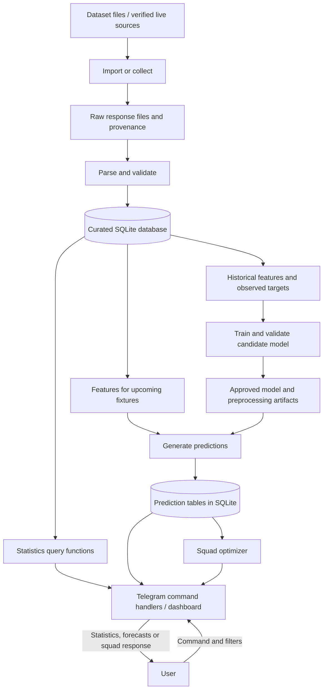

# FPL learning and analysis

Build a personal football stats tool while learning Python, SQL, statistics and boosting. Start with a small historical stats explorer; extend it with a Telegram interface, forecasts and squad optimization after the underlying pieces are validated.

**Original dataset:** [Toibinguz/epl-premier-league-dataset on Hugging Face](https://huggingface.co/datasets/Toibinguz/epl-premier-league-dataset).

The global milestones, first-product scope, acceptance checks and daily learning exercises are in [the project roadmap](docs/project_roadmap.md).

## Current data

The downloaded source dataset is at `data/raw/epl-premier-league-dataset/`. Start with these files for 2024/25:

- `raw_data/fpl_api/fpl_merged_gw_2024_2025.csv`: 27,605 player/manager-fixture records. Excluding 322 `AM` manager records leaves 27,283 records for 784 players.
- `raw_data/fpl_api/fpl_fixtures_2024_2025.csv`: 380 fixtures.
- `raw_data/fpl_api/fpl_teams_2024_2025.csv`: 20 teams.

Keep original downloads unchanged. Begin with a structural audit and then alternate validation, SQL work and EDA. The first planned product supports player leaderboards, comparisons, history plots and team result summaries; it uses existing files without live collection.

The dataset is credited to Le Truong Giang in the translated catalog. See the original dataset README for its documentation and retain attribution. Keep downloaded data and generated databases locally; the GitHub repository should track our code, SQL, notebooks, documentation and reproducible download/preparation instructions. Record the dataset revision used by a run.

## Planned application architecture

The first product reads the downloaded historical data. Collection schedules, the curated database, model jobs and Telegram service below are planned extensions, not currently deployed components.



The diagram shows data dependencies. A scheduler or an explicit run command triggers each job; a new database row does not automatically execute every downstream step.

| Process | Input → output | Proposed trigger |
|---|---|---|
| Import / collection | Files or source responses → archived raw inputs | Manually for the historical MVP; later on a schedule around matches and deadlines |
| Validation and database update | Raw inputs → consistent player, team and fixture tables | After an import; publish updates only after required checks pass |
| Statistics queries | Curated records and filters → summaries | A notebook, dashboard or bot request |
| Feature preparation | A dated data snapshot → historical training rows or upcoming-fixture features | As part of the training or prediction job |
| Training | Historical features and known actual points → candidate model | Initially manual; later a reviewed cadence after new completed gameweeks |
| Model validation and approval | Candidate and temporal evaluation results → approved model version | Before replacing the serving model |
| Prediction / inference | Approved model plus upcoming features → expected points | After relevant validated data changes and before the target deadline |
| Squad optimization | Predictions, prices and user constraints → selected squad/lineup | A user request, reusing the relevant prediction run |
| Presentation | Query/forecast/optimization results → message, table or chart | A user request |

The bot calls Python functions that query the database, retrieve predictions or run optimization. Collection and training run independently of those requests. With long polling, the bot process receives commands from Telegram while running; a public webhook is an alternative. See the [Telegram Bot API](https://core.telegram.org/bots/api#getting-updates).

## How a model runs in production

**Updating records, generating predictions and retraining are three different operations.** Our initial design uses scheduled batch predictions and a separately approved trained model.

1. **Train:** build historical examples using only information available before each prediction cutoff. The target is actual points subsequently earned. Fit preprocessing and the model on training data, select using chronological development periods, and preserve a separate final evaluation period.
2. **Save:** store the approved fitted model and preprocessing, feature definitions, dependency versions, training cutoff and evaluation results. The model is a versioned artifact on disk/object storage; its metadata can be recorded in SQLite. It is not just a table of input records. See [model persistence](https://scikit-learn.org/stable/model_persistence.html).
3. **Predict:** load that approved artifact, prepare upcoming-fixture features with the same transformations, and call prediction. Predictions can change when input features change even while the fitted model remains unchanged.
4. **Store:** write a complete prediction run to SQLite. Record the model version, feature version, data snapshot/version, generation timestamp, input cutoff, player/fixture IDs and target gameweek or horizon. Publish the run atomically so users do not receive a mixture of partially generated results.
5. **Respond:** a request such as a future `/forecast <player_id>` reads a compatible stored prediction; `/squad` can optimize over that same run. A user command does not call training. If no valid run covers the requested gameweek, report that rather than silently serving an old forecast.
6. **Evaluate and consider retraining:** after fixtures finish and actual points are available, compare predictions with outcomes. On a chosen cadence, train a candidate on an updated historical window, evaluate it on later development periods and decide whether to replace the current model. Retain the previous version for rollback. The final holdout is not repeatedly used to decide every weekly replacement.

For example, model `v1` can generate forecasts from snapshot `A`. When validated new results or availability information produce snapshot `B`, `v1` generates refreshed forecasts from `B`. A later training job may produce candidate `v2`; it becomes the serving model only after evaluation and approval. Merely receiving a new fixture, result or user request does not change the model's fitted parameters. Upcoming fixtures have no observed points target yet, so they are prediction inputs rather than newly labelled training examples.

For this first deployment, use one fixed approved model and refresh its predictions as relevant inputs change. Review forecast quality after completed gameweeks; establish a retraining cadence only after enough evidence is available. Continuous/online learning is a separate design choice and is not required here.

The initial statistics-only MVP skips model training, prediction storage and squad optimization: the user requests a summary, the query function reads curated historical records, and the bot/dashboard displays it.

## Storage and hosting

- **Original inputs:** immutable downloaded files and timestamped collection responses, with source URLs/revisions and import receipts.
- **Curated data:** SQLite tables for teams, players, fixtures and player-match records. Later add feature/prediction run metadata and predictions.
- **Model artifacts:** versioned fitted models and preprocessing stored separately from raw data, referenced by model version.
- **Application:** reusable `.py` modules and a running bot process. Notebooks remain the place for EDA and experiments.

During development these live on the Mac. A personal deployment can run on one server with persistent disk for SQLite and artifacts, plus backups. A database file must survive application restarts/redeployments. PostgreSQL can be introduced if shared access or concurrent writers justify it; it is not necessary for the first personal bot.

Responses should distinguish the time of the last successful refresh, the period actually covered by the source data, and the cutoff/model version used for a forecast. Copying an old dataset today does not make its observations current. On failed updates, preserve the last valid data and explicitly identify stale or unavailable forecasts. Keep the Telegram token outside versioned code and restrict the personal bot to the intended user/chat.

## Working structure

```text
fpl/
├── data/
│   ├── raw/epl-premier-league-dataset/  # Downloaded source files
│   ├── processed/                     # Curated outputs; FPL database is planned
│   └── pl_goals.sqlite                # Earlier scraper prototype: no player stats
├── docs/
│   ├── project_roadmap.md
│   ├── epl_raw_data_catalog_en.md
│   └── web_scraping_dataset_findings.md
├── notebooks/                         # Learning, preparation and EDA
├── src/                               # Reusable Python code and scraping exercises
├── sql/                               # Schema and query files
└── reports/figures/
```

## Existing artifacts

`notebooks/01_data_preparation.ipynb` was created before the full dataset download. Its saved run inventories links from `data/fpl_api`, a saved HTML listing. It needs updated source paths and player identity handling before it can prepare the actual downloaded files. In particular, the cleaned player-summary CSV has no player ID; use validated IDs from the player-match records.

`src/collect_pl_goals.py`, `data/pl_goals.sqlite` and the corresponding SQL files are an earlier collection prototype. The proposed live endpoint and parser remain unverified; that database is separate from the curated FPL database proposed in the roadmap.

The scraping practice session and [first lesson](docs/scraping_lesson_01.md) remain separate from the offline stats product.

## Environment

Python, pandas, JupyterLab, SQLite and Scrapy were found in the local Anaconda environment. `python` and `python3` point to different installations here; check the selected interpreter before installing packages or running commands. `requirements.txt` describes notebook dependencies and is not yet a complete environment specification for a future bot/model application.

The notebook style follows the adjacent `fraud-detection` project: numbered notebooks, short explanations, pandas summaries, explicit validation, documented transformations and saved outputs.
